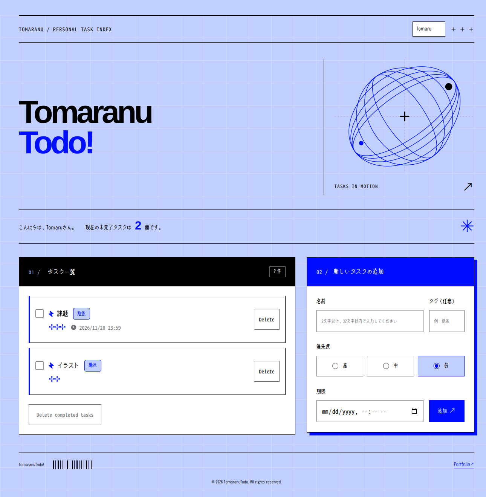

# TomaranuTodo!

💠サイトページ「[TomaranuTodo!](https://tomarurx.github.io/TomaranuTodo/)」へ



React・TypeScriptで制作した、学習や日常のタスクを管理するTodoアプリです。タスク名にタグ・優先度・期限を添えて整理でき、タスクと表示名はブラウザーに保存されます。

## コンセプト・制作の背景

課題、復習、図書の返却など、内容も期限も異なる「やること」をひとつの一覧で確認できるアプリを目指しました。タスクの名前だけでは分かりにくい用途は、任意のタグで補足できます。例えば、タスク名を「課題」、タグを「勉強」とすると、一覧で両方を続けて確認できます。

開発では、タスクの表示から始め、入力チェック、完了状態の切り替え、個別・一括削除、保存、タグ、表示名の設定へと機能を広げました。Reactの状態管理とコンポーネント分割を学びながら、自分で配色やレイアウトを調整しています。

## 主な機能

| 機能 | 内容 |
| --- | --- |
| タスク追加 | 前後の空白を除いて2〜32文字の名前で登録できます。条件を満たさない間は追加ボタンを無効にし、入力時に理由を表示します。 |
| タグ | 任意で1つ入力でき、タスク名の右側にバッジで表示します。名前・タグともに前後の空白を除去します。 |
| 優先度 | 高・中・低の3段階から選択します。一覧では高から順に「✢✢✢」「✢✢」「✢」で表します。 |
| 期限 | 日時を任意で設定できます。時刻が00:00の場合は日付だけ、それ以外は時刻も表示します。 |
| 完了切り替え | チェックボックスやタスク名のクリックで完了・未完了を切り替えます。完了時は取り消し線と「Complete!」を表示します。 |
| 未完了件数 | 一覧の状態から毎回計算し、挨拶の横に表示します。 |
| 個別削除 | 各タスクの「Delete」で、そのタスクだけを削除します。 |
| 完了タスクの一括削除 | 「Delete completed tasks」で完了したタスクだけを削除します。完了タスクがなければボタンは無効です。 |
| 表示名の設定 | 右上の「＋＋＋」の左にある入力欄から設定でき、挨拶に即時反映されます。未設定時の入力欄は「UserName」、挨拶は「Userさん」です。 |
| データ保存 | タスクと表示名をlocalStorageに保存し、ページを再表示したときに復元します。 |
| レスポンシブ対応 | PCでは一覧とフォームを横並びにし、画面が狭い場合は縦並びに切り替えます。 |

優先度は表示用で、タスクは追加した順に並びます。タグによる絞り込みや、登録後のタスク名・タグの編集機能はありません。

## 特に挑戦・工夫したところ

### 見た目と操作の両立

名前とタグを横に並べながら、長いタスク名やタグは折り返せるようにしています。入力チェックのメッセージと青い枠でエラーを伝え、チェックボックス・ラジオボタンにはラベルを付けました。キーボード操作時のフォーカス表示も残しています。

### 表示名によるパーソナライズ

表示名を変更すると、その場で挨拶へ反映されます。初期表示は「Userさん」としつつ、入力欄には薄い文字の「UserName」を表示することで、名前を設定する場所だと伝わるようにしました。挨拶は端末の時刻に応じて、午前は「おはようございます」、正午以降は「こんにちは」に切り替わります。

## 使用技術

バージョンは`package.json`の指定に基づきます。

| 分類 | 技術・ライブラリ | 用途 |
| --- | --- | --- |
| UI | React 19.3 | コンポーネント、`useState`・`useEffect`による状態管理と保存 |
| 言語 | TypeScript 6.0 | Todo型、props、イベントの型付け |
| 開発・ビルド | Vite 8.3 / `@vitejs/plugin-react` | 開発サーバーと本番ビルド |
| スタイル | Tailwind CSS 4.3 / CSS / SVG | 配色、レイアウト、レスポンシブ対応、ヘッダーのアート |
| 日付 | Day.js | 期限の表示、日時入力欄の値の整形 |
| ID生成 | uuid | タスクを識別するUUIDの生成 |
| アイコン | Font Awesome | 稲妻、時計、入力エラーのアイコン |
| クラス名 | tailwind-merge | 条件付きのスタイル指定 |
| 保存 | Web Storage API（localStorage） | ブラウザー内でタスクと表示名を永続化 |
| 品質確認 | ESLint / Prettier / TypeScript | 静的チェック、コード整形、型チェック |
| 公開 | GitHub Pages / GitHub Actions | `main`へのpushをきっかけにビルド・公開 |

## ローカルでの起動

Node.js 24とnpmを使用します。GitHub ActionsでもNode.js 24を指定しています。

```bash
git clone https://github.com/TomaruRx/react-todo-app.git
cd react-todo-app
npm ci
npm run dev
```

通常は`http://localhost:3000/TomaranuTodo/`で開けます。3000番ポートが使われている場合は、ターミナルに表示されたURLを確認してください。

| コマンド | 内容 |
| --- | --- |
| `npm run dev` | 開発サーバーを起動 |
| `npm run build` | TypeScriptのチェック後、公開用ファイルを`dist/`に生成 |
| `npm run lint` | ESLintでコードをチェック |
| `npm run preview` | ビルド済みのアプリをローカルで確認 |

## ディレクトリ構成

```text
src/
├── App.tsx              # 状態管理、保存、表示名入力、追加フォーム
├── HeroArt.tsx          # ヘッダーのSVGアート
├── WelcomeMessage.tsx   # 挨拶と未完了件数
├── TodoList.tsx         # 一覧と未登録時の表示
├── TodoItem.tsx         # タスク1件分の表示と操作
├── types.ts             # Todoの型
├── initTodos.ts         # 未保存時のサンプルデータ
└── index.css            # 配色・レイアウト・フォーカス表示
public/
├── favicon.png          # サイトのモチーフに合わせたPNGアイコン
└── favicon.ico          # ICO形式のアイコン
docs/
└── images/              # README用のスクリーンショット
.github/workflows/
└── deploy.yml           # GitHub Pagesへの公開設定
```
## バージョン履歴

### v1.0.0（2026.11.19）

初版として、以下の機能とデザインを実装しました。

- タスクの追加、名前の入力チェック、完了・未完了の切り替え
- 任意のタグ、3段階の優先度、期限の設定と表示
- タスクの個別削除、完了タスクの一括削除、未完了件数の表示
- 表示名の設定と挨拶への反映、localStorageによるタスク・表示名の保存と復元
- 5色を基調としたデザイン、SVGアート、Favicon、レスポンシブレイアウト

## 開発期間・作業時間など

- 開発期間: 2026.10.21 ~ 2026.11.19
- 作業時間: 約25時間
- 開発支援: Codex (要件の相談、コードの作成・修正、READMEの支援等)
